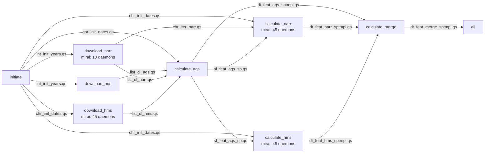

# beethoven-sm

Private development repository for transitioning NIEHS SET group's [`beethoven`](https://github.com/NIEHS/beethoven) air pollution modelling project from `targets` to Snakemake.

The current workflow prepares temporal specifications, downloads AQS, NARR, and HMS data via `amadeus`, processes AQS feature locations and observations, and calculates NARR and HMS covariates at those locations. It merges the three spatiotemporal feature tables into the default endpoint, `output/dt_feat_merge_sptmpl.qs`. Model fitting and prediction are not yet implemented in the active workflow.

Snakemake schedules the file dependencies between rules. NARR and HMS downloads and calculations also use local `mirai` worker processes within their R scripts; NARR extraction uses `mori` to share prepared locations between workers.

## Directory structure

```text
beethoven-sm/
├── Snakefile                       # Configuration, default target, rule includes
├── run.sh                          # SLURM job script and Apptainer-enabled launcher
├── run1.sh                         # Minimal local Snakemake launcher
├── config/
│   └── config.yaml                 # Date range, buffer radii, download directory
├── rules/
│   ├── a01_initiate.smk            # Date initialization
│   ├── b01_download.smk            # AQS, NARR, and HMS downloads
│   └── c01_calculate.smk           # AQS features, NARR/HMS covariates, and merge
├── scripts/
│   ├── a01_initiate.R
│   ├── b01_aqs.R
│   ├── b02_narr.R
│   ├── b03_hms.R
│   ├── c01_aqs.R
│   ├── c02_narr.R
│   ├── c03_hms.R
│   └── c99_merge.R
├── R/
│   ├── amadeus.R                  # Local mirai download and extraction helpers
│   ├── beethoven.R                # Local date helpers and reduce_merge()
│   └── helpers.R                  # Interactive launch and SLURM utilities
├── container/
│   ├── def/                       # Covariates and models container definitions
│   ├── sh/                        # Apptainer build scripts
│   └── sif/                       # Built container images
├── input/                         # Raw downloads at the configured location
├── output/                        # Serialized R objects tracked by Snakemake
├── slurm/                         # SLURM standard output and error logs
└── .snakemake/                    # Snakemake runtime state and logs
```

The `.smk` files declare dependencies, parameters, outputs, and containers. Their corresponding R scripts perform the work using the `snakemake` object. `R/amadeus.R` supplies the local mirai-enabled download and extraction functions used by the NARR/HMS scripts. `R/beethoven.R` supplies temporary local implementations of `split_dates()`, `fl_dates()`, and `reduce_merge()`. `R/helpers.R` is for interactive use and is not sourced by the workflow scripts; its `run()` helper invokes `run1.sh`, and `batch()` defaults to submitting `run.sh`. Downloaded inputs, generated outputs, container images, `.snakemake/`, and `slurm/` are ignored by Git.

## Names

Use lowercase, underscore-separated object names in the order `objecttype_stage_source_description`. Each component identifies the object's type, stage or configuration role, data source, and contents. Shared configuration and initialization objects omit the dataset source; download lists omit the additional description. For serialized objects, keep the R object name, named Snakemake input/output, and saved filename stem identical; for example, `sf_feat_aqs_sp` is saved as `output/sf_feat_aqs_sp.qs`.

| Component | Meaning | Codes used in the pipeline |
| --- | --- | --- |
| `objecttype` | Object type, class, or configured value type. | `sf`: spatial simple features; `dt`: `data.table`; `list`: list; `chr`: character values; `int`: integer values. |
| `stage` | Processing stage or configuration role. | `config`: configured values; `init`: derived initialization objects; `dl`: download results; `feat`: processed feature data; `iter`: variable selection, as in `chr_iter_narr`. |
| `source` | Dataset or combined-source result represented by the object. Not included for shared configuration or initialization objects. | `aqs`, `narr`, `hms`; `merge` for the combined feature table. |
| `description` | Contents or spatial/temporal scope. Not included for download list objects. | `daterange`: configured date endpoints; `dir`: data directory; `radii`: buffer radii; `dates`: calendar dates; `years`: included years; `datesj`: Julian-format dates (`YYYYJJJ`); `sp`: spatial only; `sptmpl`: spatiotemporal. |

Configuration names follow `objecttype_config_description` and are defined in `config/config.yaml`. Initialization outputs follow `objecttype_init_description` and are derived by `initiate`. For example, `chr_config_daterange` supplies the start and end dates used to generate `chr_init_dates`; the configuration value is not itself a `.qs` output.

Examples from the current pipeline:

| Object | Interpretation |
| --- | --- |
| `sf_feat_aqs_sp` | An `sf` object containing unique AQS feature locations for the configured period: site identifiers and spatial coordinates, without monitored PM2.5 values. |
| `dt_feat_aqs_sptmpl` | A `data.table` containing AQS feature locations and times with available PM2.5 observations. The script requests `Arithmetic.Mean` and `Event.Type` from the daily `88101` CSV files. |
| `dt_feat_narr_sptmpl` | A `data.table` of NARR covariates at AQS locations and times, combining the variables listed in `chr_iter_narr`. |
| `dt_feat_hms_sptmpl` | A `data.table` of HMS smoke-presence indicators at AQS locations and times: `light_00000`, `medium_00000`, and `heavy_00000` with the current zero-radius setting. |
| `dt_feat_merge_sptmpl` | The final `data.table`, merging AQS observations and NARR/HMS covariates by `site_id` and character-valued `time`. |
| `chr_config_daterange` | Configuration mapping with character `start` and `end` dates. |
| `chr_config_dir` | Configured download directory, resolved by the rules and passed to the R scripts under the same parameter name. |
| `int_config_radii` | Configured buffer radii in meters, reserved for buffered calculations; current NARR/HMS scripts use `radius = 0`. |
| `chr_init_dates` | Character vector of all calendar dates in the configured period. |
| `int_init_years` | Years covered by the configured period, used by the AQS and NARR download rules. |
| `list_init_dates` | List of chunks of up to 100 calendar dates, with each chunk contained within one year. |
| `list_init_datesj` | The same date chunks in Julian format (`YYYYJJJ`); the `j` suffix identifies this representation. |

The current download lists use `objecttype_stage_source`: `list_dl_aqs`, `list_dl_narr`, and `list_dl_hms`. The NARR variable selection uses the same three-part form, `chr_iter_narr`. `list_dl_collect` combines the three download results locally in `scripts/c01_aqs.R`. The calculation scripts also use temporary lists, `list_feat_narr_sptmpl` for per-variable NARR results and `list_feat_merge_sptmpl` for the three tables prepared for merging. These lists are not saved as pipeline outputs. The spatial and spatiotemporal feature outputs demonstrate the complete four-part convention.

## Configuration

Edit `config/config.yaml` before running:

| Setting | Current value | Use |
| --- | --- | --- |
| `chr_config_daterange.start` | `"2021-01-01"` | First date in the inclusive date sequence. |
| `chr_config_daterange.end` | `"2022-12-31"` | Last date in the inclusive date sequence. |
| `int_config_radii` | `1000`, `5000`, `10000` | Buffer radii in meters; unused by the current rules. NARR/HMS calculations explicitly use `radius = 0`. |
| `chr_config_dir` | `"beethoven/beethoven-sm/input/"` | Data directory, resolved relative to `$HOME` by the download and calculation rules. An absolute path can also be supplied. |

With the current configuration, downloads go to `$HOME/beethoven/beethoven-sm/input/{aqs,narr,hms}/`. If the checkout is elsewhere, update `chr_config_dir` to the intended data location. Serialized outputs remain under `output/` relative to the workflow working directory. AQS and NARR downloads receive `int_init_years`; HMS downloading and AQS/NARR/HMS processing use the endpoints of `chr_init_dates`. The initialization rule passes `chr_config_daterange.start` and `.end` to its script as the parameters `start` and `end`. `calculate_merge` declares `chr_config_dir` as a parameter, but its script reads only the three serialized feature tables.

Daemon counts are currently set directly in the R scripts, not in `config.yaml`. The local `download_narr_map()` accepts one year or two year endpoints; because `b02_narr.R` passes all of `int_init_years`, a configured period spanning more than two distinct years currently fails that helper's length check.

## Pipeline



The DAG shows declared file dependencies between rules and annotates the four rules that start mirai pools. Individual mirai tasks run inside those rules and do not create additional Snakemake nodes or declared `.qs` outputs. Configuration parameters are described above and omitted from the diagram. All `.qs` files shown are under `output/` and are written and read with `qs2`.

| Tier | Rule | R script | Behavior and outputs |
| --- | --- | --- | --- |
| initiate | `initiate` | `scripts/a01_initiate.R` | Uses `chr_config_daterange` to generate `chr_init_dates.qs` for the configured date sequence and `int_init_years.qs` for the included years. Also writes `list_init_dates.qs` for chunks of up to 100 dates within each year, and `list_init_datesj.qs` for the same chunks in `YYYYJJJ` format. |
| download | `download_aqs` | `scripts/b01_aqs.R` | Downloads AQS CSV data for the included years into the `aqs/` download subdirectory and saves the returned list as `list_dl_aqs.qs`. Retains downloaded ZIP files. |
| download | `download_narr` | `scripts/b02_narr.R` | Calls local `download_narr_map()` with 10 mirai daemons to download NARR NetCDF files for the included years and variables `air.sfc` and `weasd` into `narr/`. Saves the variable names as `chr_iter_narr.qs` and the download summary as `list_dl_narr.qs`. |
| download | `download_hms` | `scripts/b03_hms.R` | Uses `fl_dates()` to pass the configured date endpoints to local `download_hms_map()` with 45 mirai daemons. Downloads and unzips shapefiles under `hms/`, retains the ZIP files, and saves the download summary as `list_dl_hms.qs`. |
| calculate | `calculate_aqs` | `scripts/c01_aqs.R` | Reads `chr_init_dates.qs` and all three download lists. Uses `amadeus::process_aqs()` in `location` mode to save spatial locations as `sf_feat_aqs_sp.qs`, and in `available-data` mode to save PM2.5 observations by location and time as `dt_feat_aqs_sptmpl.qs`. |
| calculate | `calculate_narr` | `scripts/c02_narr.R` | Reads `chr_init_dates.qs`, `chr_iter_narr.qs`, and `sf_feat_aqs_sp.qs`. Processes variables in sequence and calls local `calculate_narr_mirai()` to distribute each variable's raster layers across 45 daemons. Uses `radius = 0`, `fun = "mean"`, and `geom = FALSE`, then merges the variable results into `dt_feat_narr_sptmpl.qs`. |
| calculate | `calculate_hms` | `scripts/c03_hms.R` | Reads `chr_init_dates.qs` and `sf_feat_aqs_sp.qs`. Processes HMS files and calls local `calculate_hms_map()` to distribute date-specific smoke polygons across 45 daemons. Uses `radius = 0`, default `frac = FALSE`, and `geom = FALSE` to produce smoke-presence indicators in `dt_feat_hms_sptmpl.qs`. |
| calculate | `calculate_merge` | `scripts/c99_merge.R` | Reads the AQS, NARR, and HMS spatiotemporal feature tables, converts their `time` columns to character strings, and joins them on `site_id` and `time` with `reduce_merge()`. Saves `dt_feat_merge_sptmpl.qs`. |
| — | `all` | None | Requests `output/dt_feat_merge_sptmpl.qs` as the default target. |

The tier identifies the rule's processing stage. `all` selects the workflow endpoints and has no processing tier. No `model` or `predict` rules are defined yet.

The three download rules can run independently after `initiate`, subject to Snakemake's scheduling limit. Each dataset is handled by one rule invocation for the whole configured period; there are no per-date, per-year, or per-variable wildcard jobs. Within NARR/HMS rules, mirai distributes downloads or extraction tasks as described below. `list_init_dates.qs` and `list_init_datesj.qs` have no downstream consumers yet; `chr_iter_narr.qs` is consumed by `calculate_narr`.

`calculate_aqs` depends on all three download lists and combines them locally as `list_dl_collect`, while its feature processing reads the AQS files under `aqs/data_files/`. Once it produces `sf_feat_aqs_sp.qs`, `calculate_narr` and `calculate_hms` can run independently. They read raw data from `narr/<variable>/` and `hms/data_files/`, respectively. Their downloads are prerequisites through `calculate_aqs`; NARR also directly depends on `chr_iter_narr.qs` from `download_narr`.

The AQS, NARR, and HMS spatiotemporal outputs are explicitly saved as `data.table` objects. The final merge converts each input's `time` column with `as.character()` before joining on `site_id` and `time`. `reduce_merge()` preserves left-side rows by default and switches to full joins for the reduction if any consecutive input table has more rows than its predecessor. This helper is used both to combine NARR variables and to merge the three feature tables. Missing matches remain missing; the merge does not generate a complete site-by-time grid or impute missing values.

Snakemake tracks the declared `.qs` outputs. Individual raw downloads are not declared rule outputs, so removing a raw file alone does not make its download rule out of date. All three download scripts pass `acknowledgement = TRUE` and `hash = FALSE`; AQS uses `amadeus::download_data()`, while NARR and HMS use the local map functions.

## Parallel execution with mirai

The NARR/HMS scripts source `R/amadeus.R`, start their local worker pools with `mirai::daemons(n)`, and collect results before saving the rule outputs. Each script calls `mirai::daemons(0)` after its download or calculation returns successfully. The helpers detect active daemons and have sequential fallback paths, but the current scripts always start the pools listed here.

| Rule | Local entry point | Unit dispatched to mirai | Daemons |
| --- | --- | --- | --- |
| `download_narr` | `download_narr_map()` | One URL/destination pair for a required NetCDF file. | 10 |
| `download_hms` | `download_hms_map()` | One URL/destination pair for a required daily smoke file. | 45 |
| `calculate_narr` | `calculate_narr_mirai()` | One raster layer within the current NARR variable. | 45 |
| `calculate_hms` | `calculate_hms_map()` | One date's smoke polygons, evaluated at all supplied locations. | 45 |

The download helpers discover required files, filter existing destinations with `amadeus::check_destfile()`, and dispatch the remaining URL/destination pairs through `download_run_mirai()`. That dispatcher uses `mirai::mirai_map()` to call `amadeus::download_run_method()` and combines success, failure, and skipped counts plus failed URLs/files. The defaults `max_tries = 20` and `rate_limit = 2` are passed to each task; they do not impose a shared limit across all workers. HMS ZIP extraction runs after downloads are collected.

NARR variables still run through an outer sequential `lapply()`. For each variable, `amadeus::process_narr()` prepares the raster, then `calc_worker_mirai()` maps `calc_extract()` over its layers. Raster layers are packed with `terra::wrap(..., proxy = TRUE)`, and prepared `sf` locations are shared with `mori::share()`. Workers unwrap the raster layers and perform extraction; the controller binds their results and later merges the variable tables.

HMS processing first calls `amadeus::process_hms()` in the controlling R process, then maps `calc_hms_extract()` over date-specific polygon subsets. Both polygons and prepared sites are packed with `terra::wrap()` and unwrapped in the workers. With the current `radius = 0` and `frac = FALSE`, the helper produces binary light, medium, and heavy smoke indicators and fills missing smoke-column values with zero. The script's `fun = "mean"` argument is not used by this local HMS helper.

Mapped jobs are collected with `mirai::collect_mirai(..., options = ".stop")`, so worker errors stop collection. AQS download/processing, initialization, and the final merge do not start mirai pools.

The daemon counts are independent of `--cores`, `SLURM_CPUS_PER_TASK`, and `snakemake@threads`. The rules currently declare no `threads:` or worker resources, so Snakemake does not account for these pools when scheduling jobs. Concurrent NARR/HMS calculations can start 90 daemons in total, exceeding the 50 CPUs requested by `run.sh`; even `--cores 1` still permits a running script to start its fixed pool. Set the daemon counts in the four R scripts to fit the available allocation and any concurrently running rules.

## Containers

Run the workflow from the `beethoven-sm` directory with Snakemake and Apptainer available on the host. Every active R rule uses `container/sif/container_covariates.sif`.

The covariates build definition uses `rocker/geospatial:latest`, installs `pak`, `qs2`, `mirai`, and `mori`, and installs `amadeus` from `NIEHS/amadeus` without a branch or commit pin. It disables user R profiles and environment files inside the container. `R/amadeus.R` is sourced from the checkout by the workflow scripts. Rebuild an older image if it lacks the new mirai/mori dependencies. The models definition and build script provide a separate GPU modelling environment, but no current rule uses that image.

If the covariates image needs to be built, run the following from `beethoven-sm`. The build script uses paths relative to `container/sh` and requires Apptainer fakeroot support and network access:

```bash
mkdir -p container/sif
(cd container/sh && bash build_container_covariates.sh)
```

## Run

Run commands from `beethoven-sm`. For a SLURM submission, create the log directory first:

```bash
mkdir -p slurm
sbatch run.sh
```

`run.sh` requests the `geo` partition, one task, 50 CPUs, and 10 GB of memory. It writes `slurm/cov_<jobid>.out` and `.err` and includes email notifications for completion or failure. Review the allocation and notification directives for the intended environment. Snakemake and the local mirai pools run within this single allocation; no Snakemake cluster executor or remote mirai deployment is configured.

The Snakemake core limit is selected from the first script argument, then `SLURM_CPUS_PER_TASK`, then a fallback of `1`. `run.sh` also exports `CURL_CA_BUNDLE` and `SSL_CERT_FILE` as `/etc/ssl/certs/ca-certificates.crt` for download certificate verification.

For direct execution in an existing allocation or a suitable local environment:

```bash
bash run.sh 50
# Minimal launcher used by R/helpers.R's run():
bash run1.sh 50
```

Calling `bash run.sh` directly does not request SLURM resources. `run1.sh` defaults to one Snakemake core and accepts an explicit core count; it has no SLURM directives or certificate exports. Both launchers invoke `snakemake --cores <cores> --use-apptainer -p`. These core limits control Snakemake scheduling; mirai pool sizes must be considered separately as described above. Use Snakemake directly for additional options.

To inspect planned work without executing the R scripts or downloads:

```bash
snakemake --cores 50 --use-apptainer -n -p
```
